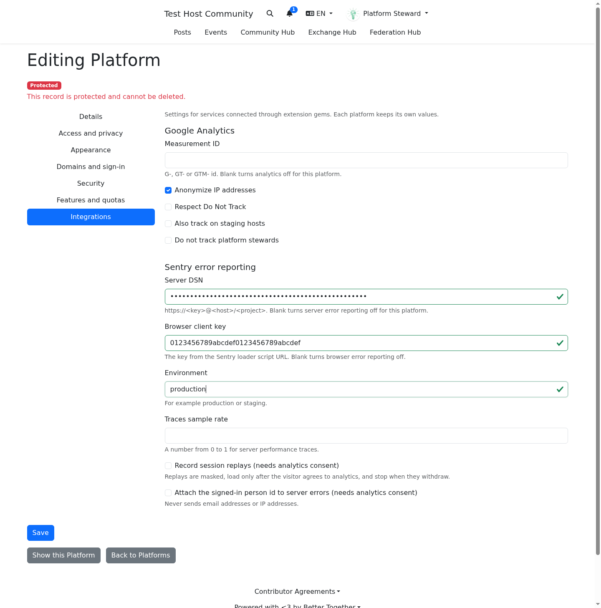
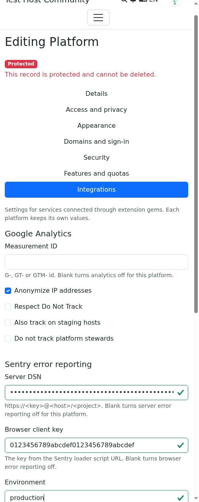

# Better Together Sentry

Adds [Sentry](https://sentry.io) error reporting to a [Community Engine](https://github.com/better-together-org/community-engine-rails) host app, configured per platform and respecting visitor consent.

## What it is for

- **Server error reporting.** Starts Sentry for the host app, and lets each platform report to its own Sentry project (or to none). An exception on one platform never lands in another platform's project.
- **Browser error reporting.** Adds the Sentry browser script for platforms that have a client key.
- **Privacy by default.** No email addresses, usernames or IP addresses are sent. Session replay and attaching the signed-in person id are opt-in per platform and only run after the visitor consents to analytics.
- **Sensible performance defaults.** 5 percent trace sampling, no profiling, and no traces for health checks, assets or storage requests.
- **Cookie policy.** Registers its entries with the platform's cookie policy page.

## Where you configure it

Platform stewards open **Edit platform, Integrations**. The Sentry group appears there once the gem is installed (the Google Analytics group in the screenshot comes from [better_together-google-analytics](https://github.com/better-together-org/better_together-google-analytics)).



On a phone the same tab stacks into one column:



The screenshots use example values only. The DSN is a secret field: it is masked after saving and never logged in full.

## Requirements

- Community Engine `>= 0.11.0` with the platform Integrations tab (`BetterTogether.register_platform_setting`). Consent features need the consent system as well.
- Ruby `>= 3.2`. The gem depends on `sentry-rails`.

## Installing in a host app

1. Add the gem to the host app's `Gemfile`:

   ```ruby
   gem 'better_together-sentry', github: 'better-together-org/better_together-sentry', branch: 'main'
   ```

   Pin a `tag:` or `ref:` for production. While developing locally you can use `path: '../better_together-sentry'`.

2. Install:

   ```bash
   bundle install
   ```

   There are no migrations and no generators. The gem registers itself when Rails boots.

3. Create a Sentry project and copy its DSN (Settings, Client Keys). For browser reporting also copy the key from the loader script URL (`https://js-de.sentry-cdn.com/<key>.min.js`).

4. Sign in as a platform steward, open **Edit platform, Integrations**, fill in the Server DSN and, if wanted, the Browser client key, Environment and Traces sample rate, then save. Repeat per platform.

5. Check it: trigger a test error on a non-production environment and confirm it arrives in the right Sentry project.

### Host platform from the environment

For the host platform only, these variables work as a fallback when the form is blank, so existing apps keep working: `SENTRY_DSN`, `SENTRY_CLIENT_KEY`, `SENTRY_ENVIRONMENT`, `SENTRY_TRACES_SAMPLE_RATE`. `GIT_REV` sets the release. Other platforms never inherit these. If the app already calls `Sentry.init` in an initializer, that call wins.

## Per-platform settings

Requires a Community Engine with `BetterTogether.register_platform_setting` (the platform Integrations tab). Each platform sets its own values:

| Setting | Meaning |
|---------|---------|
| Server DSN | `https://<key>@<host>/<project>`. Blank turns server error reporting off for the platform. Masked in the form and never logged in full. |
| Browser client key | The key in the Sentry loader script URL. Blank turns the browser script off. |
| Environment | For example `production` or `staging`. |
| Traces sample rate | 0 to 1, server traces (default 0.05, like the host apps). |
| Record session replays | Opt-in, needs analytics consent. |
| Attach person id to server errors | Opt-in, needs analytics consent. |

Environment defaults (host platform bootstrap):

- `SENTRY_DSN` enables initialization
- `GIT_REV` sets the Sentry release (left unset when blank so Sentry can auto-detect it)
- `breadcrumbs_logger` defaults to `[:active_support_logger, :http_logger]`
- `SENTRY_TRACES_SAMPLE_RATE` defaults to `0.05` (values outside 0..1 fall back to the default)
- `SENTRY_PROFILES_SAMPLE_RATE` defaults to `0` (profiling also needs stackprof or vernier)
- `SENTRY_TRACES_SAMPLER`: unset/`default` uses a parent-aware sampler that honours an upstream
  sampling decision and never traces `/healthcheck`, `/up`, `/assets`, `/cable`,
  `/rails/active_storage` or `/packs`; `always` traces every request (legacy); `disabled` uses
  only `SENTRY_TRACES_SAMPLE_RATE`
- `SystemExit` is excluded from error reports

These defaults match the values the NL Venues, Better Together and Newfoundland Labrador Online
host apps already set. The bootstrap runs after `config/initializers`, so a host app's own
`Sentry.init` wins.

`SENTRY_DSN`, `SENTRY_CLIENT_KEY`, `SENTRY_ENVIRONMENT` and `SENTRY_TRACES_SAMPLE_RATE` still work, as a fallback for the host platform only (other platforms never inherit them). `GIT_REV` sets the release. `send_default_pii` is always false.

A platform without a DSN reports nothing: it never sends its errors into the host platform's project. The process-wide `Sentry.init` is made from the environment (host platform); any other DSN gets its own client.

## Consent decision (an assumption the owner can overturn)

- Essential, no banner, disclosed on the cookie policy page: server error reporting, and the basic browser error script with no replay, no cookies, no identity. Server events carry the error and where it happened (request id, method, controller, action, path without query string). Email addresses, usernames and IP addresses are never sent.
- Analytics category, loaded only after consent: session replay (masked text, inputs and media), and attaching the signed-in person id to server errors. Withdrawing consent stops replay without a reload.

The server side learns about consent from `consent:` in the reporting context (a decision hash or a list of categories) or `Current.consent`. Community Engine does not pass it yet, so until it does the person id is never attached.

## Content Security Policy

CE registers CSP sources globally, so the gem registers only the origins the environment implies for the host platform. A platform with its own client key and DSN must add the Sentry ingest origin (for example `https://o123.ingest.sentry.io`) to its platform CSP connect sources, and `https://js-de.sentry-cdn.com` to script sources, until CE supports platform-scoped registration. `CspSources.origins_for(platform)` gives the exact list.

## Development

```bash
bundle exec rake test      # unit tests (needs sentry-ruby)
BETTER_TOGETHER_CE_LIB=/path/to/community-engine-rails/lib bundle exec rspec   # cookie policy specs
bundle exec rubocop
```

The rspec suite uses Community Engine's shared examples (`better_together/cookie_policy/rspec`) and skips when they are not on the load path.

If you need more control, replace the registration in an initializer:

```ruby
BetterTogether.register_adapter(:error_reporting, :sentry) do |exception, context: {}|
  Sentry.capture_exception(exception, tags: { subsystem: 'ce' }, extra: context)
end
```

## License

LGPL-3.0-or-later, see `LICENSE`.
